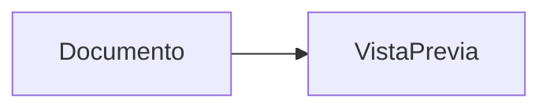

# Doc Craft para VS Code

Vista previa en vivo de Markdown y diagramas Mermaid, sin depender de un CDN.

## Uso

1. Abre un archivo `.md`, `.markdown`, `.mmd` o `.mermaid`.
2. Ejecuta **Doc Craft: Abrir vista previa** desde la paleta de comandos o el botón de la barra del editor.
3. Edita el documento: la vista previa se actualiza automáticamente.

Soporta encabezados, tablas, listas, enlaces, imágenes relativas y bloques de código. Para incluir un diagrama en Markdown:

````md

````

Los archivos `.mmd` y `.mermaid` se interpretan como diagramas completos. Los errores de sintaxis aparecen junto al código del diagrama. El HTML crudo está deshabilitado y Mermaid usa el modo `strict`.

Esta versión inicial no incluye edición visual, exportación ni sincronización de desplazamiento.
